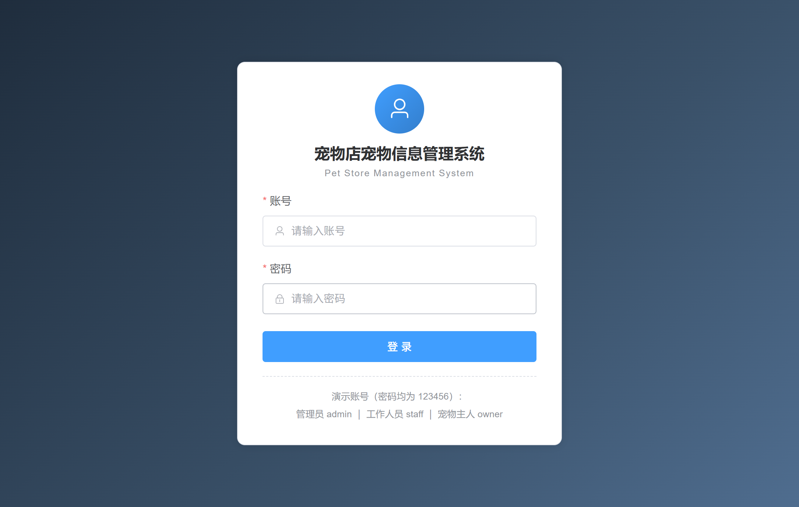
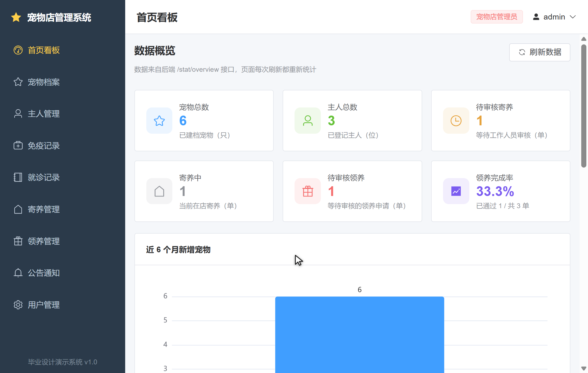
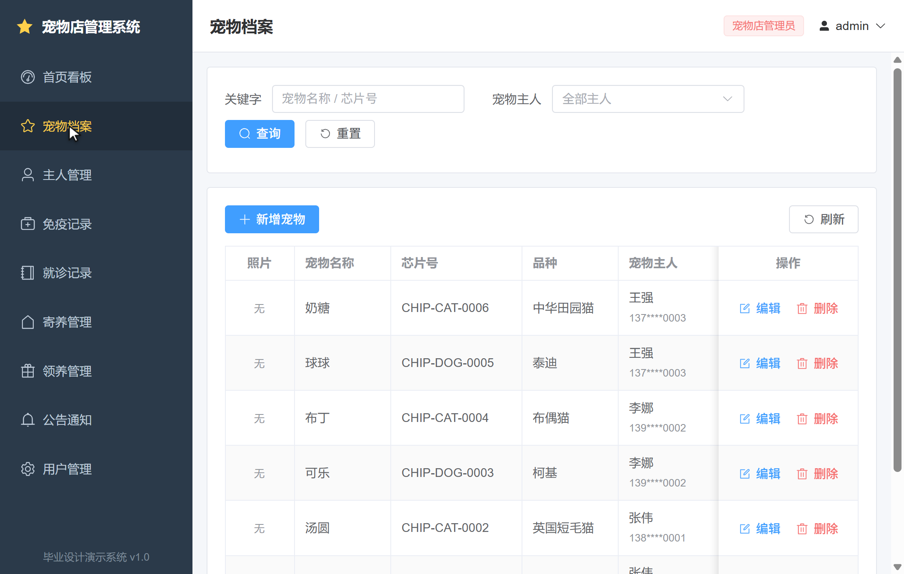
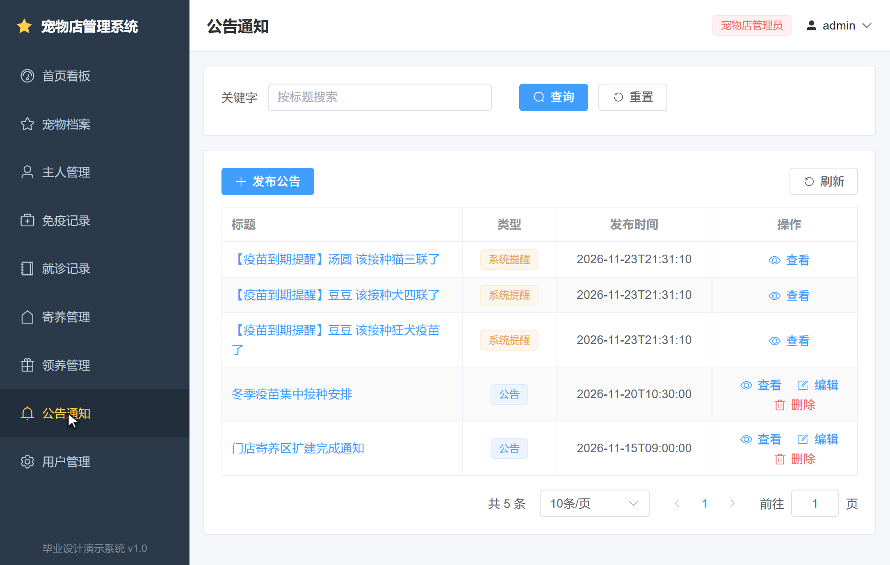
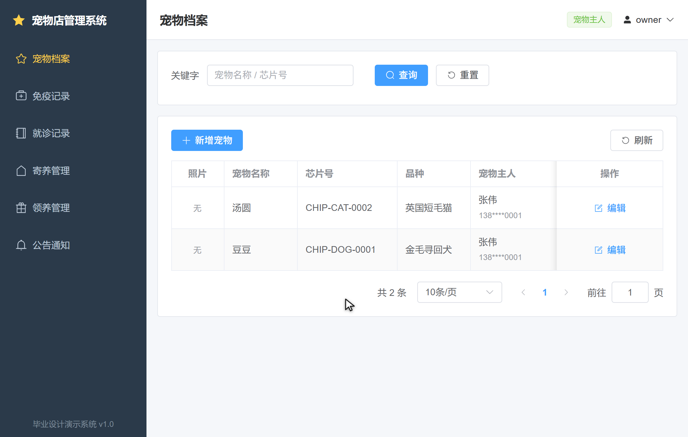

# 宠物店信息管理系统（毕业设计）

> Spring Boot 3 + Vue 3 + MySQL 的前后端分离管理系统，服务 **宠物店管理员 / 店员 / 宠物主人** 三类角色，覆盖宠物档案、免疫与就诊、寄养、领养、到期提醒、公告与统计看板。

---

## 一句话介绍

后端提供 10 组 JSON 接口，前端提供 10 个页面，数据库共 9 张表；三角色通过 JWT + 权限码控制访问，主人只能看到自己名下的宠物与预约。

## 功能概览

| 模块 | 说明 |
| --- | --- |
| 登录与权限 | JWT 认证，三种角色权限数分别为 1 / 17 / 11 项，接口级 `@PreAuthorize` 校验 |
| 宠物档案 | 增删改查、芯片号唯一约束、分页与模糊查询、主人数据隔离 |
| 免疫与就诊 | 疫苗按周期自动推算到期日、7 天内到期提醒、就诊记录关联宠物 |
| 寄养管理 | 申请—审核—驳回（必填理由）状态流转，仅待处理/已驳回可删除 |
| 领养管理 | 申请、审核、通过后自动转移宠物归属、通过后回访 |
| 公告与提醒 | 公告发布权限校验、系统提醒只读、重复生成幂等 |
| 统计看板 | 宠物数、主人数、领养率、疫苗到期分布（逾期 / 7 天 / 30 天 / 更晚） |

## 技术栈

| 层次 | 技术 |
| --- | --- |
| 后端 | Java 17、Spring Boot 3、MyBatis-Plus、Spring Security + JWT、Maven |
| 前端 | Vue 3、Vite、Element Plus、Pinia、Axios |
| 数据库 | MySQL 8（9 张表，外键 + 唯一索引约束） |
| 工具 | Git、Postman、Node.js |

## 快速开始

```bash
# 1. 建库建表
mysql -u root -p < src/db/schema.sql

# 2. 启动后端（首次启动自动创建三个演示账号）
cd src/backend && mvn spring-boot:run

# 3. 导入演示数据（必须在后端首次启动之后）
mysql -u root -p pet_store < src/db/demo-data.sql

# 4. 启动前端
cd src/frontend && npm install && npm run dev
```

演示账号（口令均为 `123456`）：`admin` 管理员 ｜ `staff` 店员 ｜ `owner` 主人。

详细步骤见 [docs/部署与运行说明.md](docs/部署与运行说明.md)。

## 目录结构

| 路径 | 内容 |
| --- | --- |
| `src/backend/` | Spring Boot 后端源码（`com.ningcong.petstore`） |
| `src/frontend/` | Vue 3 + Vite 前端源码 |
| `src/db/` | `schema.sql` 建库建表与角色权限、`demo-data.sql` 演示数据 |
| `docs/` | 接口清单、测试用例、部署说明、架构说明、答辩脚本、实测记录 |
| `tools/` | 一键启动脚本、接口冒烟脚本、前后端静态自检 |

## 接口与文档

- [接口清单（10 组接口）](docs/接口清单.md)
- [测试用例（85 条手工用例）](docs/测试用例.md)
- [技术栈与架构说明](docs/技术栈与架构说明.md)
- [部署与运行说明](docs/部署与运行说明.md)
- [系统实测记录（2026-11-25，84 条接口断言）](docs/实测记录-2026-11-25.md)

## 测试情况

2026-11-25 完成一轮接口层实测：黑盒调用 10 组接口，执行 **84 条断言**，覆盖正常路径、边界值、越权访问与非法输入。

- 断言全部符合系统设计预期，**未发现功能性缺陷**；
- 覆盖点包括：三角色登录与权限数、无 token / 伪造 token 返回 401、主人越权 403、芯片号重复被唯一索引拦截、删除被引用数据被拒、疫苗到期日自动推算、领养通过后归属转移、权限码校验、分页边界、手机号脱敏等；
- 明细见 [docs/实测记录-2026-11-25.md](docs/实测记录-2026-11-25.md)。

## 界面截图

| 登录页 | 数据看板 |
| --- | --- |
|  |  |

| 宠物档案 | 公告与疫苗提醒 |
| --- | --- |
|  |  |

| 主人视角 |
| --- |
|  |

## 作者

宁聪 ｜ 南昌工学院 软件工程（本科）2027 届 ｜ 3319899796@qq.com

## 已知边界

- 前端为课程/毕设规模实现，10 个页面覆盖主流程，未做移动端适配；
- 业务错误统一返回 HTTP 200 + `{code, message, data}` 结构，仅鉴权 401 与越权 403 设置 HTTP 状态码（统一返回体设计取舍）；
- 未做并发压测与单元测试全覆盖。